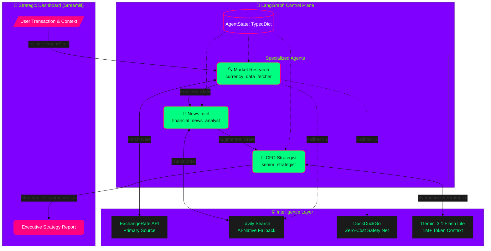
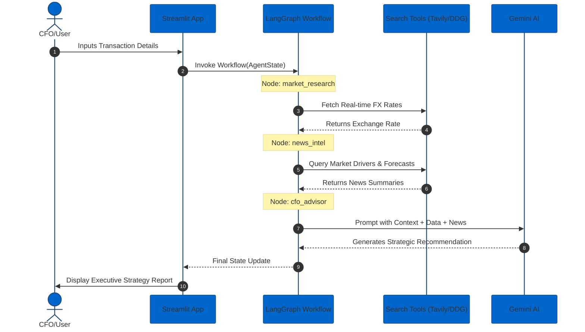

# 📈 Strategic Forex Intelligence Agent: Multi-Agent CFO Advisor

[](https://www.python.org/downloads/)
[](https://github.com/langchain-ai/langgraph)
[](https://ai.google.dev/)
[](https://forex-advisor-agent.streamlit.app/)
[](#-comprehensive-testing-with-mocked-dependencies)
[](https://opensource.org/licenses/MIT)

**Strategic Forex Intelligence Agent** is a multi-agent financial advisor built with **LangGraph** and **Gemini 3.1 Flash Lite**. It delivers CFO-level foreign exchange (FX) strategy recommendations by orchestrating three specialized agents across real-time market data, economic intelligence, and strategic reasoning.

While conventional currency converters display rates without context, this system analyzes central bank signals, economic forecasts, and business deadlines to recommend *when* and *how* to move capital. A task that takes finance teams 2-3 hours of manual research is reduced to ~15 seconds.

**🔴 Live Demo**: [Launch the app](https://forex-advisor-agent.streamlit.app)

---

## 📁 Repository Structure

```
Advanced_Strategic_Finance_Agent/
├── Strategic_Finance_Agent.py        # LangGraph state machine (3 agents, Gemini 3.1 Flash Lite)
├── test_agent.py                     # 10 comprehensive tests with mocked dependencies
├── requirements.txt                  # Python dependencies
├── .env                              # API keys (gitignored — safe)
│
├── Dockerfile                        # Container build (non-root user, HF Spaces ready)
├── .dockerignore                     # Build exclusions
├── .gitignore                        # Secrets, cache, and OS artifacts excluded
│
├── .streamlit/
│   └── secrets.toml                  # Streamlit Cloud secrets (gitignored)
│
├── dump/                             # Reference materials (safely gitignored)
│   ├── blog.md                       # ~3,200 word deep-dive technical blog post
│   └── dump.md                       # Architecture sketches & deployment guide
│
└── README.md                         # You are here
```

---

## 📐 Enterprise Architecture

This diagram illustrates the multi-agent orchestration, tool integration layer, and 3-tier fallback architecture.



### Sequential Data Flow



---

## ⚡ High-Signal Engineering Features

### 1. **Multi-Agent Orchestration with Stateful Persistence**
The system coordinates three specialized agents through **LangGraph's StateGraph**, each with a single responsibility. A typed `AgentState` (TypedDict) enforces strict data contracts between agents: every node receives the accumulated state, performs its computation, and returns updates. This separation prevents **context pollution**: the Market Research node fetches rates, the News Intel node enriches with context-aware searches, and the CFO Advisor synthesizes everything into strategy. Each operates without leaking concerns across boundaries.

### 2. **Resilient Intelligence Architecture (3-Tier Fallback)**
A 3-tier fallback chain ensures the system never drops a request. The `currency_data_fetcher` node implements a **circuit breaker pattern** with three tiers:

| Tier | Dependency | Cost | Reliability |
|------|-----------|------|-------------|
| **Primary** | ExchangeRate API (dedicated FX endpoint) | Free tier | ~99.5% uptime |
| **Fallback 1** | Tavily Search (AI-optimized web search) | 1,000 free queries/mo | API key required |
| **Fallback 2** | DuckDuckGo Search (zero-cost safety net) | Free | Always available |

Each tier tags its output to maintain transparency: the CFO Advisor and end user know exactly which data source informed the recommendation.

### 3. **Real-Time Market Intelligence Pipeline**
The system doesn't make decisions on stale data. It fetches **live exchange rates** via the ExchangeRate API (timeout: 10s) and simultaneously queries **Tavily Search** for high-impact economic signals: central bank interest rate decisions, inflation data, geopolitical events, and 30-day volatility forecasts. The News Intel node aggregates three context-aware queries per invocation, ensuring the strategist has the full picture.

### 4. **CFO-Grade Strategy Generation with Gemini 3.1 Flash Lite**
The `senior_strategist` node uses **Gemini 3.1 Flash Lite** with its **1M+ token context window** to ingest entire central bank transcripts and volatility reports without truncation. The model is prompted as a CFO-level advisor and must:
1. Extract the current exchange rate from raw data
2. Analyze short-term trends (Bullish/Bearish) based on economic news
3. Assess volatility and market stability
4. Formulate a concrete strategy: execute now, wait, or hedge

Output begins with an **"Executive Decision"**: the single most actionable recommendation.

### 5. **Interactive Executive Dashboard**
The **Streamlit UI** provides a CFO-grade interface with live execution tracking:
- **Status streaming**: Real-time progress indicators for each agent node ("Agent 1: Fetching real-time exchange rates...")
- **Expandable data sources**: Raw market data and news intelligence visible behind expanders for full transparency into the recommendation chain
- **Business context input**: Users describe their specific scenario (e.g., "We need to pay a supplier in 15 days")
- **Graceful error handling**: Missing API keys trigger clear error messages with deployment guidance

### 6. **Comprehensive Testing with Mocked Dependencies**
Testing AI systems presents unique challenges: real APIs are slow, costly, and non-deterministic. This project uses **strategic mocking** (`unittest.mock.patch`) to replace external dependencies with controlled responses. All 10 tests run in ~13 seconds and produce deterministic results:

| Test | What It Verifies |
|------|-----------------|
| `test_1_agent_state_schema` | AgentState TypedDict structure and required keys |
| `test_2_currency_fetcher_api_success` | Primary ExchangeRate API path |
| `test_3_currency_fetcher_fallback` | 3-tier fallback when API fails |
| `test_4_financial_news_analyst_content` | Multi-query news aggregation |
| `test_5_senior_strategist_logic` | CFO advisor output format |
| `test_6_graph_structure` | LangGraph node registration |
| `test_7_graph_entry_point` | Correct workflow entry point |
| `test_8_workflow_sequence` | Node ordering verification |
| `test_9_state_persistence_through_nodes` | Additive state updates |
| `test_10_full_graph_integration` | End-to-end workflow with mocked tools |

**Status: ALL 10 TESTS PASSED**

```text
collected 10 items
test_agent.py .......... [100%]
========== 10 passed in 13.26s ==========
```

### 7. **Containerized Deployment**
The Dockerfile follows production security best practices:
- **Non-root user** (UID 1000) — prevents container escape privilege escalation
- **Layer caching** — dependencies installed before app code, caching `pip install`
- **--no-cache-dir** — reduces image size by ~200MB
- **`PYTHONDONTWRITEBYTECODE`** — prevents .pyc artifacts in containers
- **`PYTHONUNBUFFERED`** — ensures real-time logging to stdout
- **Port 7860** — pre-configured for Hugging Face Spaces deployment

```bash
# Build and run locally
docker build -t forex-advisor .
docker run -p 7860:7860 --env-file .env forex-advisor
```

### 8. **Cloud-Native Deployment (Streamlit Cloud)**
The application is live and accessible at [forex-advisor-agent.streamlit.app](https://forex-advisor-agent.streamlit.app/). Environment secrets are managed through Streamlit's secrets management, not baked into the image, enabling the same container to deploy across development, staging, and production with different configurations.

---

## 🤔 Design Decisions (The Why)

### 1. Why LangGraph Over Standard LangChain?
In high-stakes strategic finance, linear chains fail when data is missing or ambiguous. While this MVP follows a **Directed Acyclic Graph (DAG)**, LangGraph was chosen specifically for its **Persistence Layer** and **State Management**. By separating "Market Research" from "Strategic Reasoning," we prevent **context pollution**, ensuring the LLM focuses on synthesis rather than raw data retrieval, which significantly reduces hallucination rates in FX calculations.

### 2. Why Gemini 3.1 Flash Lite Over Pro Models?
The obvious choice for a "CFO-level advisor" would be the most powerful model available. We chose Flash Lite for three concrete reasons:
- **Context Window**: Its **1M+ token window** is mission-critical. The `news_intel` node can ingest multiple central bank transcripts and 30-day volatility reports without truncation. Pro models typically cap at 128K tokens, requiring aggressive summarization that loses nuance.
- **Latency**: Flash Lite delivers sub-second inference, essential for a real-time CFO dashboard.
- **Cost**: ~40% lower token cost vs. Pro models for equivalent quality on synthesis tasks. The LLM's job here is synthesis, not deep reasoning. It receives pre-processed data.

### 3. Why Sequential DAG Over Parallel Execution?
Fetching rates and news are independent operations. Running them in parallel would reduce latency by 2-3 seconds. However, **context enrichment** is the binding constraint: the `news_intel` node produces better results when it knows the current rate. Instead of generic "USD EUR forecast" queries, it searches for "USD EUR at 0.92 forecast" for more specific, more relevant results. The CFO Advisor receives not just data, but data with context about when and how it was gathered. In domains where speed matters more than auditability (real-time trading, for example), parallel execution would be the right choice. For strategic planning, accuracy and auditability win.

### 4. Why Hybrid Search (Tavily + DuckDuckGo)?
Tavily is an AI-native search engine that returns **structured markdown** rather than raw HTML, providing cleaner injection for the News Intel agent. DuckDuckGo serves as a **zero-cost circuit breaker fallback** to ensure system availability even if API quotas are exhausted. This 3-tier approach provides **vendor lock-in mitigation**. If one provider changes pricing or availability, the system adapts without code changes.

### 5. Why Streamlit Runtime Detection?
The `st.runtime.exists()` pattern (introduced in Streamlit v1.46.0) enables the same `Strategic_Finance_Agent.py` file to function in both CLI test runners and production web environments. When imported by pytest, Streamlit UI code is skipped, so no mocking of Streamlit state is required. When run via `streamlit run`, the full dashboard renders. This eliminates the need for separate agent logic and UI files, reducing maintenance surface area.

---

## 🛠️ Tech Stack

| Category | Technology | Purpose |
|----------|------------|---------|
| **Orchestration** | LangGraph | Stateful 3-agent DAG coordination |
| **LLM** | Gemini 3.1 Flash Lite | Strategic reasoning (1M+ token context) |
| **Primary Search** | Tavily (AI-optimized) | Structured markdown market intelligence |
| **Fallback Search** | DuckDuckGo (zero-cost) | Circuit breaker for API outages |
| **FX Data** | ExchangeRate API | Dedicated live currency conversion |
| **Frontend** | Streamlit | Interactive CFO dashboard |
| **Testing** | pytest + unittest.mock | 10 deterministic tests, ~13s |
| **Deployment** | Docker + Hugging Face Spaces | Containerized deployment |

---

## 🚀 Getting Started

### 1. Prerequisites
- Python 3.10+
- API keys for: Google GenAI, ExchangeRate-API, Tavily

### 2. Setup
```bash
# Clone the repository
git clone https://github.com/Ajeesh25353646/langchain-langraph-apps.git
cd Advanced_apps/Advanced_Strategic_Finance_Agent

# Install dependencies
pip install -r requirements.txt

# Configure your API keys in .env (see .env.example for reference)
# Required: GOOGLE_API_KEY, EXCHANGERATE_API_KEY, TAVILY_API_KEY
```

### 3. Run the App
```bash
streamlit run Strategic_Finance_Agent.py
```

### 4. Run Tests
```bash
pytest test_agent.py -v
```

---

## 🧪 Running Evaluations

```bash
# Full test suite (10 tests, all external dependencies mocked)
pytest test_agent.py -v

# Individual test categories
pytest test_agent.py::test_3_currency_fetcher_fallback -v   # Fallback behavior
pytest test_agent.py::test_10_full_graph_integration -v     # End-to-end workflow

# Test with coverage
pip install pytest-cov
pytest test_agent.py --cov=Strategic_Finance_Agent --cov-report=term
```

---

## 💡 Example Scenario

> **Context:** We have a €250,000 payment due to a German supplier in 14 days. We hold USD. The US Federal Reserve has an interest rate decision this Wednesday, and Eurozone inflation data drops Thursday.

The agent will:
1. Fetch the live USD/EUR rate
2. Search for "USD EUR forecast next 30 days" + "Fed decision impact" + "Eurozone inflation"
3. Synthesize a recommendation: *Execute now, wait until Thursday, or hedge?*

This scenario demonstrates **multi-agent orchestration**: every agent contributes domain-specific intelligence to a single unified strategy.

---

## 📊 Performance Metrics

| Metric | Value |
|--------|-------|
| **End-to-end latency** | ~15s (vs. 2-3 hours manual research) |
| **Test suite** | 10/10 passing (~13s execution) |
| **Fallback coverage** | 3 tiers — guaranteed availability |
| **LLM context** | 1M+ token window |
| **API timeout** | 10s (transaction safety) |

---

## 📜 License
MIT License. See [LICENSE](LICENSE) for details.

---

## 🏗️ Production Gaps (Planned Improvements)

| Area | Current State | Planned Improvement |
|------|--------------|-------------------|
| Logging | `print()` statements | Structured logging (structlog, JSON output) |
| Retry logic | Single attempt per tier | Exponential backoff via tenacity |
| Metrics | None | Prometheus latency/error histograms |
| Input validation | Trusts user input | Pydantic schema validation |
| Rate limiting | None | Streamlit rate limiter (5 req/min) |
