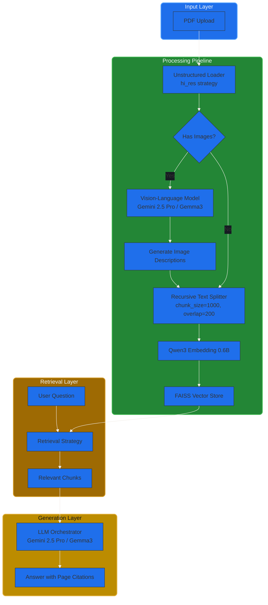
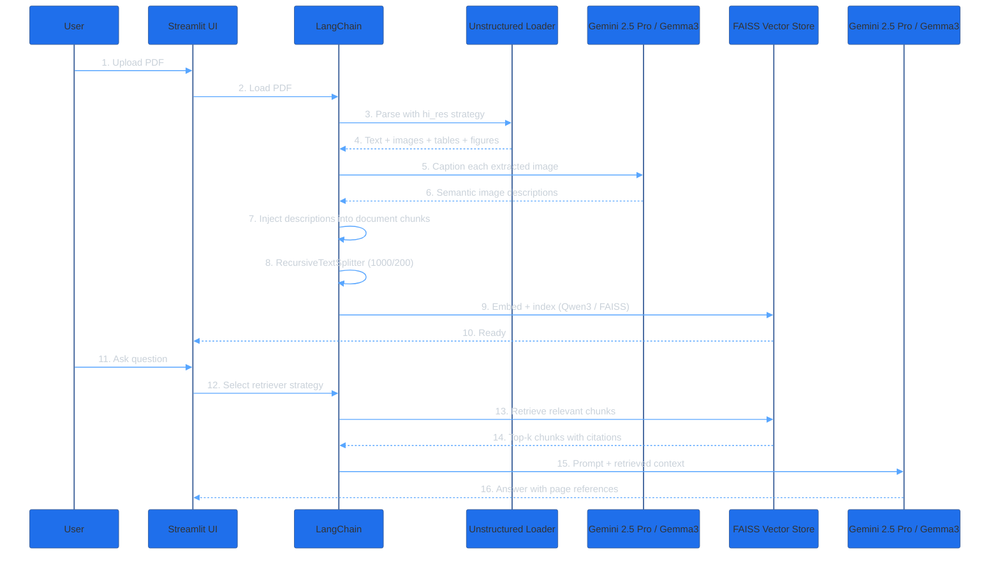

# Multimodal PDF RAG

[](https://www.python.org/downloads/)
[](https://github.com/langchain-ai/langchain)
[](https://ai.google.dev/)
[](https://ollama.com/)
[](https://streamlit.io/)
[](https://github.com/facebookresearch/faiss)
[](https://opensource.org/licenses/MIT)

Multimodal PDF RAG is a retrieval-augmented generation system that answers questions on PDF documents containing images, tables, charts, and figures. It uses Vision-Language Models to caption visual elements and LangChain retrievers to ground answers in page-level document context.

---

## The Problem

Conventional PDF RAG systems extract only text, ignoring charts, tables, and figures that carry critical information. A financial report's revenue chart or a medical paper's treatment diagram is invisible to text-only retrieval. This system solves that by routing every visual element through a VLM (Gemini 2.5 Pro or Gemma3), generating semantic descriptions that are injected back into the document text. The result is a searchable document corpus where images are as queryable as prose.

---

## Project Structure

```
Multimodal_PDF_RAG/
├── Advanced_multimodal_rag.py   # Main application: Streamlit UI, LangChain pipeline, VLM captioning
├── requirements.txt             # Python dependencies (LangChain, Unstructured, FAISS, etc.)
├── .env.example                 # Template for GOOGLE_API_KEY and OLLAMA_BASE_URL
├── temp.pdf                     # Sample PDF used for demonstration / testing
├── Extracted_images/            # Images extracted from the sample PDF (10 pages)
│   ├── image_0.jpeg
│   ├── image_1.jpeg
│   ├── ...
│   └── image_9.jpeg
└── README.md                    # This file
```

---

## Architecture



### Sequential Data Flow



---

## 8 Engineering Details

### 1. VLM-Based Image Captioning Pipeline

Each extracted image, table, and figure is passed to a Vision-Language Model that generates a structured text description. The caption prompt includes the image category label, any OCR text already extracted, and any pre-existing caption. Descriptions are injected back into the document chunks, replacing the raw image data. This enables text-based retrievers to match queries against visual content they could not index otherwise.

### 2. Dual-Mode Inference (Cloud + Local)

Users toggle between two inference backends at runtime without restarting:

| Mode | Model | Latency | Privacy | Dependency |
|------|-------|---------|---------|------------|
| Cloud | Gemini 2.5 Pro | ~2s per query | Data sent to Google | GOOGLE_API_KEY |
| Confidential | Gemma3 (4B) via Ollama | ~5-10s per query | 100% local | Ollama + gemma3:4b |

The flag propagates through the VLM captioning step, the LLM answer generation, and the retrieval strategy configuration from a single `local_model` toggle.

### 3. Three Retrieval Strategies with a Shared Vector Store

The system exposes three LangChain retrievers, each suited to a different query profile:

| Retriever | k | Best For | Mechanism |
|-----------|---|----------|-----------|
| MultiQueryRetriever | 15 | Complex, multi-faceted questions | Generates query variations, retrieves for each, deduplicates |
| VectorStoreRetriever | 20 | Fast, general queries | Direct cosine similarity |
| ContextualCompressionRetriever | 20 base | High-precision answers | LLMChainFilter removes irrelevant chunks |

All three share the same FAISS index. The user selects one at query time via dropdown.

### 4. Streamlit Caching for Sub-Second Follow-Up Queries

Two Streamlit cache decorators handle the expensive operations:

- `@st.cache_data` caches PDF loading results (loaded docs across runs)
- `@st.cache_resource` caches the local Ollama model instance

Initial PDF processing runs 30-60 seconds (Unstructured parsing + VLM captioning + embedding). Subsequent queries against the same PDF return in under 2 seconds because the vector store and model references are already in memory.

### 5. Unstructured.io hi_res Parsing with Image Extraction

The `UnstructuredLoader` uses the `hi_res` strategy with `extract_images_in_pdf=True` and `infer_table_structure=True`. It extracts images to base64 payloads attached to each document chunk's metadata. The extraction targets three categories (`Image`, `Table`, `Figure`) and preserves page numbers, coordinates, MIME types, and caption text. This metadata flows through captioning and into the retrieval context for page-level citation.

### 6. Image Download Gallery

When the "Save Images" toggle is enabled, a `@st.fragment` renders each extracted image inline with a download button. Images are decoded from base64 to their original format and served with correct MIME types and filenames. This runs independently of the RAG pipeline and does not block question answering.

### 7. Base64 Image Matching for Description Injection

The captioning function matches each generated description to its source document by comparing `image_base64` fingerprints in the metadata. This avoids positional assumptions: even if the Unstructured loader returns documents in a different order than images are extracted, the correct chunk gets the description injected.

```python
for doc in _Docs:
    if doc.metadata.get('image_base64') == image_base64:
        doc.page_content = description
        doc.metadata = {'page_number': ..., 'category': 'GeneratedDescription'}
        break
```

### 8. Prompt Template with Grounded Answer Enforcement

The generation prompt explicitly constrains the LLM to use only the provided document excerpt. If the answer cannot be found in the retrieved chunks, the model is instructed to respond "Not enough information in the provided document" rather than hallucinating. Retrieved chunks include page numbers and category labels, which the LLM uses to produce citations.

---

## Design Decisions

### Why LangChain over raw API calls?

LangChain provides three retriever implementations that share the same vector store interface. Building MultiQueryRetriever, ContextualCompressionRetriever, and VectorStoreRetriever from scratch would mean duplicating query expansion logic, chain-filter orchestration, and deduplication. LangChain also standardizes the UnstructuredLoader integration, the HuggingFace embeddings wrapper, and the FAISS persistence layer. The abstraction cost is minimal when all three retrievers use the same `Retriever` interface and the same prompt template.

### Why two VLM models instead of one?

Gemini 2.5 Pro produces higher-quality image captions and faster answers. Gemma3 runs entirely offline. Both serve the same interface (image captioning + answer generation) but serve different deployment constraints. The toggle propagates through the pipeline via a single boolean flag, so adding a third model (e.g., GPT-4o, Claude) requires changing one condition branch rather than rewriting the orchestration.

### Why sequential RAG over agentic retrieval?

The system processes PDF ingestion (load, caption, embed, index) as a single sequential pipeline. This is deliberate: the document is static, all chunks are needed for indexing, and none of these operations depend on the user's query. Making this agentic (e.g., retrieving images on demand during conversation) would add latency to every query without improving recall, since all images must be captioned at least once anyway.

### Why Unstructured.io over PyMuPDF or pdfplumber alone?

PyMuPDF extracts text but does not segment tables, figures, or track image regions by category. Unstructured.io's `hi_res` strategy runs layout detection on each page, extracts images to base64 payloads with page numbers and coordinates, and infers table structure. The PDF-only `PyPDFLoader` is still available as a fallback when multimodal mode is disabled. The two loaders coexist in the codebase, selected by a user toggle.

### Why Qwen3 Embeddings over OpenAI or Gemini embeddings?

Qwen3-Embedding-0.6B is the smallest model on the MTEB leaderboard's top-10 that supports multilingual text. It runs locally via `sentence-transformers` with no API dependency or per-document cost. OpenAI embeddings add per-token cost and require an internet connection. For a system that already supports a local inference mode, the embedding step should also work offline.

---

## Tech Stack

| Category | Technology | Purpose |
|----------|------------|---------|
| Orchestration | LangChain 0.2 | LLM integration, retriever abstraction, prompt chaining |
| LLM (Cloud) | Gemini 2.5 Pro | Primary answer generation and VLM captioning |
| LLM (Local) | Gemma3 (4B) via Ollama | Confidential-mode inference, zero external data transfer |
| Image Captioning | Gemini 2.5 Flash / Gemma3 | VLM-based description of diagrams, charts, and tables |
| Embeddings | Qwen3-Embedding-0.6B | Local text vectorization via sentence-transformers |
| Vector Store | FAISS (CPU) | In-memory similarity search, session-persistent index |
| Document Parsing | Unstructured.io (hi_res) | Layout-aware extraction of text, images, and tables from PDFs |
| UI | Streamlit | Web interface with file uploader, chat, and image gallery |
| Caching | Streamlit cache decorators | `@st.cache_data` (documents), `@st.cache_resource` (models) |
| Image Processing | Pillow, base64 | Decode, display, and download extracted images |

---

## Getting Started

### Prerequisites

- Python 3.11+
- Google API key for Gemini models (or Ollama installed for local mode)
- ~4 GB disk space for embedding model cache

### Setup

```bash
# Clone and enter the project
git clone https://github.com/Ajeesh25353646/langchain-langraph-apps.git
cd langchain-langgraph-apps/Advanced_apps/Multimodal_PDF_RAG

# Install dependencies
pip install -r requirements.txt

# Set up environment (only needed for cloud mode)
cp .env.example .env
# Edit .env with your GOOGLE_API_KEY

# For local mode: install Ollama and pull the model
# ollama pull gemma3:4b

# Run
streamlit run Advanced_multimodal_rag.py
```

### Verification

Upload a PDF, select a retrieval strategy, and ask a question. The answer should include page number references. Toggle "Multimodal mode" to compare text-only vs. VLM-augmented answers. Toggle "confidential documents" to switch between cloud and local inference.

---

## Example Scenario

**Input:** A 10-page PDF containing a quarterly earnings report with revenue charts, balance sheet tables, and executive commentary.

1. Upload the PDF to the Streamlit interface (30-60s processing)
2. Toggle "Multimodal mode" on
3. Select "MultiQueryRetriever" for complex analysis
4. Ask: "What was Q3 revenue and how does it compare to Q2?"
5. The system retrieves chunks containing both the chart description and the surrounding text
6. Answer cites page 4 (revenue chart) and page 3 (quarterly comparison table)
7. Toggle "Save Images" to download the chart as a JPEG

---

## Performance Metrics

| Metric | Measured Value | Notes |
|--------|---------------|-------|
| PDF Processing (first load) | 45-60 seconds | hi_res parsing + VLM captioning + embedding |
| Follow-up query latency | < 2 seconds | Cached vector store and model instances |
| Memory usage (local mode) | ~6 GB RAM | Gemma3 (4B) + Qwen3 embedding model |
| Memory usage (cloud mode) | ~2 GB RAM | Embedding model only |
| Retrieval coverage | 3 strategies | MultiQuery, VectorStore, ContextualCompression |
| Document sources | Unlimited | FAISS in-memory, re-indexed per session |

---

## License

MIT

---

## Production Gaps

| Gap | Impact | Planned Fix |
|-----|--------|-------------|
| No test suite | Regressions from code changes not caught | Add pytest unit tests for retriever selection and prompt formatting |
| FAISS is in-memory only | Vector store resets when Streamlit restarts | Add FAISS serialization and re-load via `FAISS.load_local()` |
| Single-session document scope | No cross-document queries | Implement index merge across sessions or SQLite-backed store |
| No async streaming | Answers arrive as a block after full generation | Replace `chain.invoke()` with streaming via `Chain.stream()` for progressive output |
| VLM captioning runs on every load | Repeating same work across sessions | Cache image descriptions to disk keyed by PDF hash |

